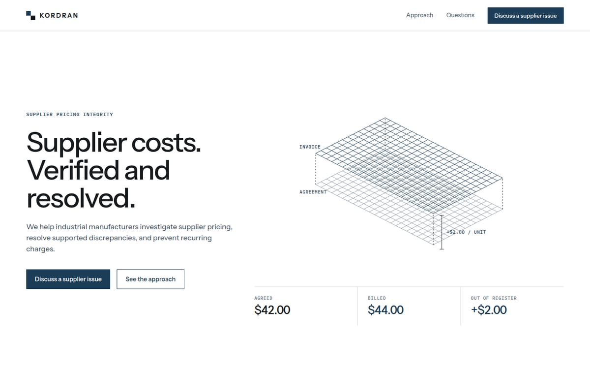
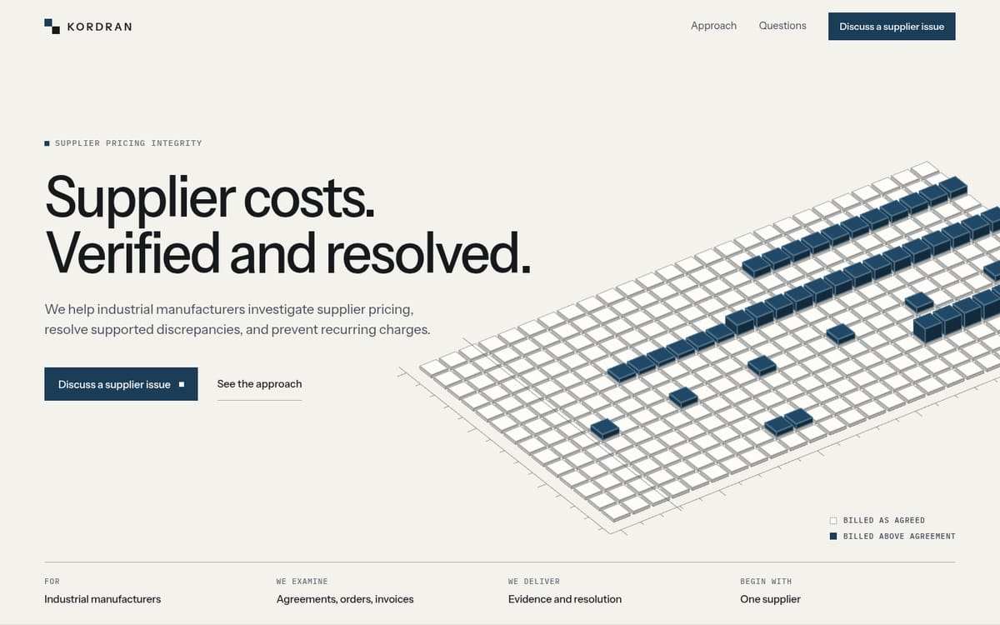
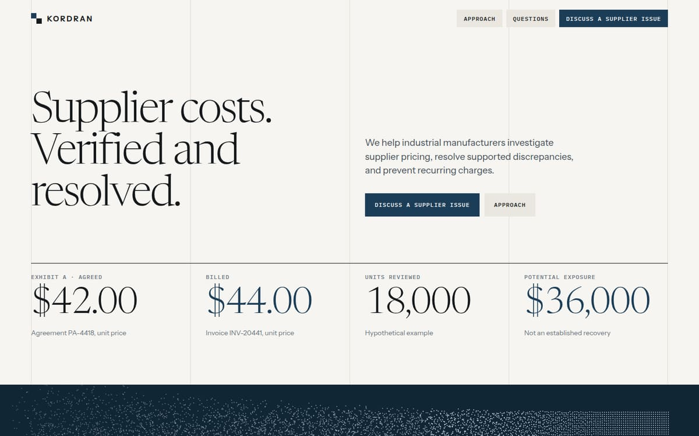

# 3. Three concepts

Three directions were built as working pages and inspected in a browser at
1440px and 390px before any was chosen. Each makes a different argument about
what Kordran is. The prototypes are in [`prototypes/`](prototypes/).

---

## Direction A — Register

Prototype: [`direction-a-register.html`](prototypes/direction-a-register.html)

1. **Creative thesis.** Kordran is an instrument. Two layers of records are
   brought into register, and the offset between them is the finding.
2. **Reference influences.** Hadrian's wireframe drawings, Linear's
   isometric line figures, Palantir's labelled diagrams, and the previous
   Kordran hero.
3. **Distinctive visual language.** White ground, hairline wire lattices,
   dimension lines with mono labels, teal for the offset layer only.
4. **Hero concept.** Two stacked wire grids labelled "agreed" and "billed",
   with a dimension line marking the gap between them, above a strip of
   three figures: $42.00, $44.00, +$2.00.
5. **Motion concept.** The upper lattice drifts and settles onto the lower
   one. Lines draw on entry.
6. **Supporting graphic system.** Line-only figures, numbered rows, ruled
   tables.
7. **Homepage rhythm.** Hero, three-figure strip, ruled list of what is
   examined, method, contact. Even and quiet.
8. **Approach page treatment.** A sequence of line diagrams, one per step.
9. **Mobile adaptation.** The lattice scales down cleanly because it is
   only lines, but below about 400px the lines thin out and the gap is hard
   to see.
10. **Primary strengths.** Light, fast, accessible, close to the existing
    brand, no risk of looking like a game.
11. **Main weaknesses.** It needs its caption. Without the labels a visitor
    sees a wireframe box. It is also close to what the site already had,
    which was judged too thin.
12. **Estimated engineering complexity.** Low. SVG and CSS only.
13. **Fit.** Safe and correct, and not memorable. It would not give Kordran
    anything it could own.

---

## Direction B — Plate

Prototype: [`direction-b-plate.html`](prototypes/direction-b-plate.html),
[`plate.js`](prototypes/plate.js)

1. **Creative thesis.** Kordran is a surface plate. Records are machined
   tiles laid on a flat reference. What matches sits flush. What was billed
   above the agreement stands proud and can be measured.
2. **Reference influences.** Orderful's tiled panels and isometric
   explanation, Lusion's flat-toned solids, Monumental's paper ground,
   Teenage Engineering's commitment to a single physical device, and
   metrology practice itself.
3. **Distinctive visual language.** Warm paper, solid tiles in three flat
   face tones, constant-width edges, teal caps on the raised tiles, datum
   ticks along two edges, a small legend set like a drawing's title block.
4. **Hero concept.** A 28 × 14 plate in axonometric projection entering
   from the right behind the headline. Raised runs show the patterns Kordran
   actually looks for: a price that changes partway through a contract, a
   recurring surcharge every fourth invoice, a single large outlier.
5. **Motion concept.** A narrow band of light crosses the plate like an
   inspection pass. The plate tilts a few degrees toward the pointer. Hover
   reads out a tile ("Line 05 · Invoice 14 — Billed above agreement"). As the
   page scrolls, raised tiles settle flush: the correction.
6. **Supporting graphic system.** The same tile, projection, and tones draw
   every figure. Records become sheets. Quantities become unit squares.
7. **Homepage rhythm.** Open plate, then a tight worked example on a sheet,
   then three small figures, then a dark band for the method, then a quiet
   purpose statement, questions, contact, and the painting.
8. **Approach page treatment.** A three-stage figure (records, then
   reconciliation, then resolution) and a stack of record sheets that can be
   selected one at a time.
9. **Mobile adaptation.** The plate is cropped, not shrunk: it sits below
   the copy and bleeds off both edges, so tiles stay large enough to read.
10. **Primary strengths.** Understood without a caption. Material, which
    suits physical industry. Built from the logo's own square. Holds up as a
    still image.
11. **Main weaknesses.** A grid of blocks can drift toward a game or a city
    model if it gains gloss, shadows, or bright color. It needs strict tone
    control. It is the heaviest of the three to build well.
12. **Estimated engineering complexity.** Medium. One instanced mesh and a
    small shader, plus an SVG twin so the first paint and the fallback are
    the same picture.
13. **Fit.** Strong. It depicts the service, it is specific to Kordran, and
    it extends to every other figure the site needs.

---

## Direction C — Exhibit

Prototype: [`direction-c-exhibit.html`](prototypes/direction-c-exhibit.html)

1. **Creative thesis.** Kordran is an evidence file. The site is a set of
   exhibits, each a number with its source and its caveat.
2. **Reference influences.** Hyperliquid's serif and full-height rules,
   Robinhood's serif display, DataRobot's ticks, financial annual reports.
3. **Distinctive visual language.** A serif display face (Newsreader),
   full-height column rules, chip navigation, very large figures, one dark
   band.
4. **Hero concept.** Headline in serif at left, then four large numbers on
   the rules: $42.00, $44.00, 18,000, $36,000. Under them a dark band
   holding 18,000 dots, one per unit.
5. **Motion concept.** Numbers count in. The dot band fills from left to
   right. Rules draw downward.
6. **Supporting graphic system.** Tables, exhibit numbers, footnotes,
   marginal labels.
7. **Homepage rhythm.** Editorial columns throughout. Even, typographic.
8. **Approach page treatment.** A report: numbered chapters with marginal
   notes and one table per stage.
9. **Mobile adaptation.** Good. Type and rules reflow naturally; the dot
   band becomes a strip.
10. **Primary strengths.** The best at carrying text and numbers. Elegant.
    Light to build.
11. **Main weaknesses.** It follows Hyperliquid closely enough to be
    recognized as such. The serif and large dollar figures read as wealth
    management, and lead with money before the reader knows what the
    company does. There is nothing physical in it.
12. **Estimated engineering complexity.** Low to medium. CSS, one canvas
    for the dots.
13. **Fit.** Partly. Its structure (exhibits, sources, caveats beside
    numbers) suits Kordran well. Its surface does not.

---

## Signature-visual concepts

Four candidates for the one live scene were analysed. Two were prototyped.

### Reconciliation field

- **Represents:** Two lattices of points, agreed and billed, that come into
  alignment.
- **Belongs because:** Reconciliation is the service.
- **Behaves:** Layers drift apart and settle; the pointer pulls them
  slightly out of register.
- **Appears:** Hero. This was the previous site's graphic and Direction A.
- **Mobile:** Works, but thins out.
- **Difficulty:** Low. Points or line segments.
- **With motion off:** Weak. A still frame is two faint grids.
- **Verdict:** Rejected. It needs explaining.

### Surface plate (selected)

- **Represents:** The reconciliation matrix. Rows are price lines, columns
  are invoices, height is the amount billed above the agreement.
- **Belongs because:** It is the actual comparison Kordran performs, drawn
  with a tool from the customer's own shop.
- **Behaves:** Inspection light, small pointer tilt, hover readout, raised
  tiles settle on scroll.
- **Appears:** Homepage hero only. Smaller static figures elsewhere reuse
  its geometry as SVG.
- **Mobile:** Cropped to a band under the copy. Pointer effects are absent;
  the light pass and scroll settle remain.
- **Difficulty:** Medium. 442 instances (392 tiles and 50 caps) in one draw
  call, a short shader, ray picking against boxes.
- **With motion off:** Strong. The still drawing carries the whole meaning,
  and it is what ships as server-rendered SVG.

### Unit field

- **Represents:** Every unit in the worked example as a mark: 18,000 of
  them, with the affected ones in teal.
- **Belongs because:** It turns a dollar figure into a countable quantity.
- **Behaves:** Fills in order; a subset changes state when a claim is
  validated.
- **Appears:** Prototyped in Direction C as a dark band.
- **Mobile:** Becomes a strip. 18,000 marks are too fine to read on a phone.
- **Difficulty:** Low as points.
- **With motion off:** Acceptable, though it reads as texture.
- **Verdict:** Kept as an idea, moved out of WebGL. It became the unit grid
  in the exhibits: 180 squares, each 100 units, drawn in HTML and CSS, so it
  is readable, accessible, and costs nothing.

### Industrial matter and network (rejected on paper)

- **Industrial matter:** Lit metal billets with physical materials. It
  would look impressive and say nothing about the service. It also pulls
  toward product rendering and game lighting, and needs environment maps
  and tone mapping that the page does not otherwise need.
- **Network of economics:** Nodes for suppliers, lines for flows. It is the
  most common picture in enterprise software, and Kordran does not sell a
  network.

### Why three.js for the plate, and where it stops

Three.js was already a dependency. The scene is one `InstancedMesh` with a
custom `ShaderMaterial`, so per-tile animation runs on the GPU. A 2D canvas
could draw the same picture with less code shipped, but hover picking and
the per-tile settle would run on the main thread every frame. The decision
that matters more is the SVG twin: the server renders the same geometry from
the same model, so the first paint, the reduced-motion view, and the
no-WebGL view are all the finished drawing. The live scene is only ever an
upgrade.
