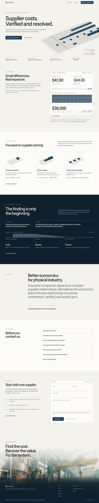
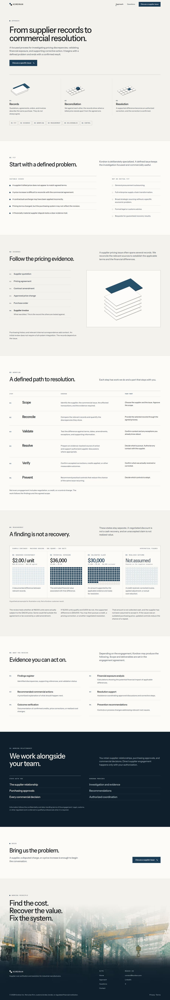
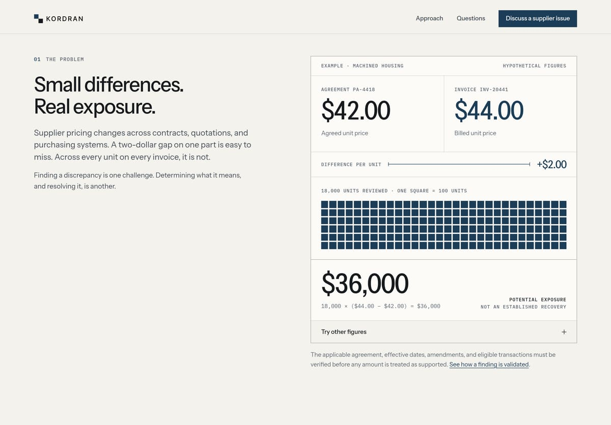
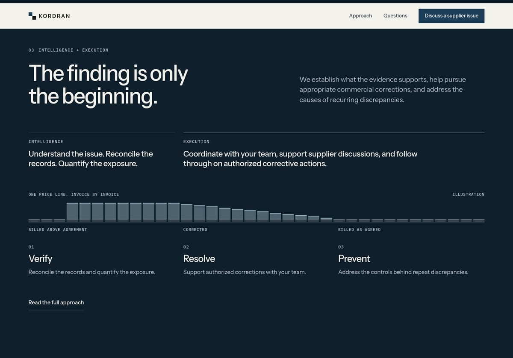
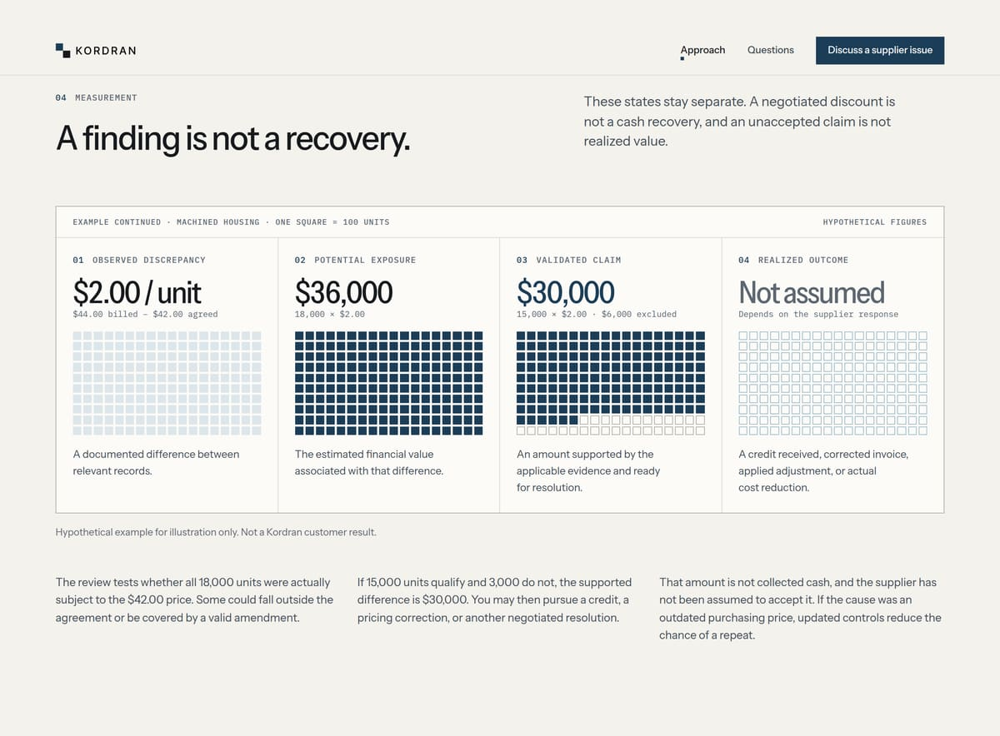
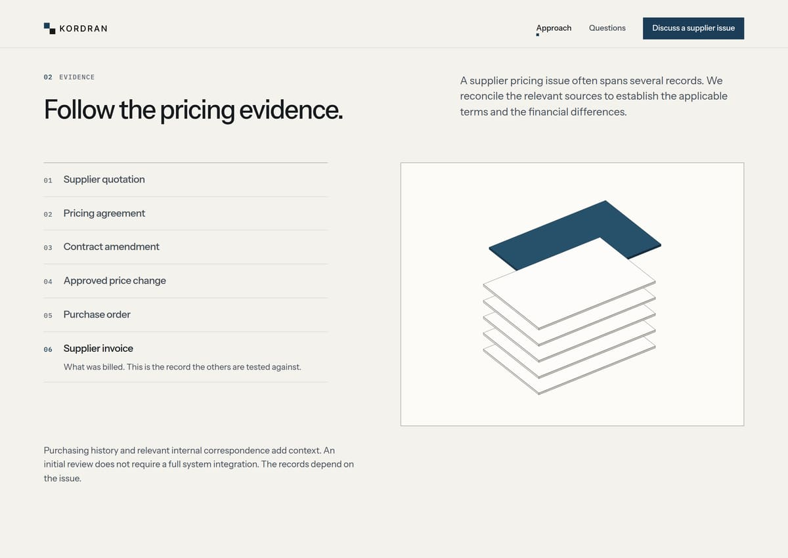
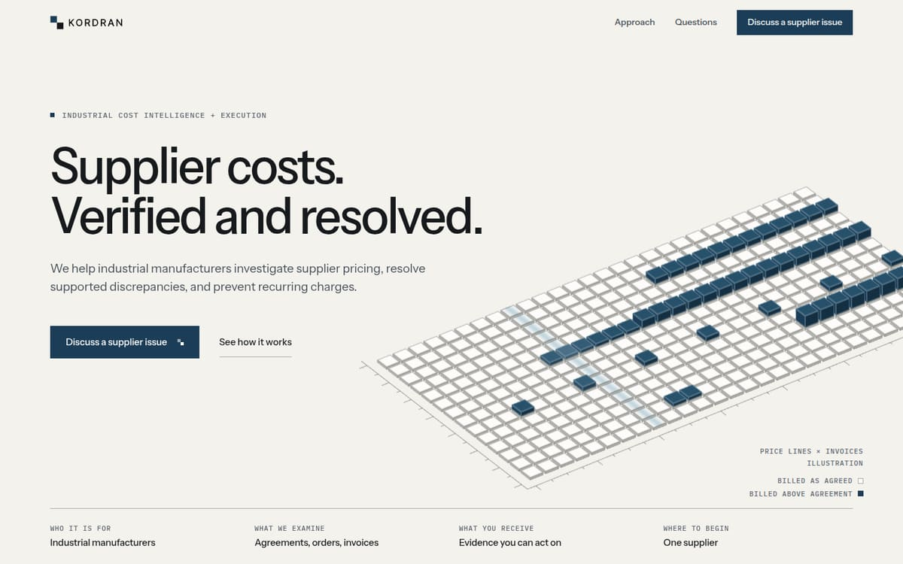
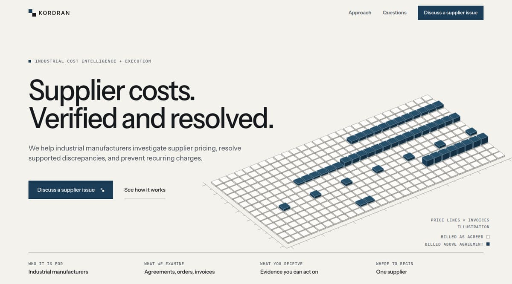
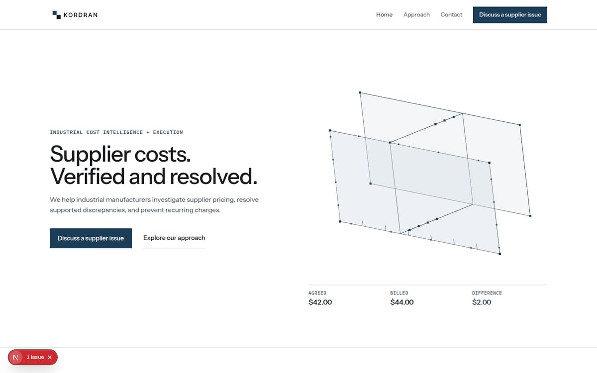

# 8. QA and validation

Everything here was run on 13 November 2026 against a production build
(`next build`, `next start`) on the development machine, in Chrome driven by
Puppeteer. WebGL was rendered in software. Nothing was deployed.

## What these results do and do not establish

- Layout, links, accessibility rules, keyboard order, fallbacks, and form
  validation were tested directly and the results are reliable.
- Performance figures are **lab numbers from a local server**. They show the
  page is light and stable. They are not field Core Web Vitals. Time to
  first byte on a real network will be higher.
- "Worst interaction" is the longest Event Timing duration across a scripted
  set of interactions. It indicates INP; it is not a field INP.
- The contact form's success path could not be exercised because the local
  environment has no database credentials. The handled failure path was.
- No manual screen-reader pass was done.

## Visual QA

### Final screens

| | |
| - | - |
|  |  |
| Homepage at 1440px | Approach at 1440px |

| | |
| - | - |
|  |  |
| Homepage at 390px | Approach at 390px |

Details:

- 
- 
- 
- 
- 
- 

For comparison, the previous hero:



Full-resolution captures at 1440, 768, and 390px, hero captures at 1440,
1280, 1024, 390, and 320px, and a 72-second interaction recording were
delivered with the work as run artifacts.

### Widths inspected

Both pages were toured frame by frame at 1440, 1280, 1024, 768, 390, and
320px. The hero was also checked at 1920, 1360, 1200, 1120, 480, 414, and
360px, on short screens at 1120 × 700, 1280 × 720, and 1360 × 768, and the
closing scene at 1920, 1440, 1280, 1024, 900, 768, and 390px.

### Interaction review

| Interaction | Result |
| ----------- | ------ |
| Plate goes live after first paint | The SVG is replaced by the canvas with no visible jump; both are drawn from the same model and frame |
| Inspection light | A pale band crosses the plate every 18 seconds |
| Pointer over the plate | Plate tilts slightly; the tile under the pointer is highlighted and named in the legend |
| Scroll past the hero | Raised tiles settle flush over the first 460px |
| "Try other figures" | Opens; changing a price or quantity updates the difference, the unit grid, the total, and the formula; non-numeric input shows "Enter numeric figures to calculate the difference." |
| Evidence stack | Hover, focus, or click selects a record; its sheet lifts and turns teal |
| Questions | Native disclosures; one click opens, the plus becomes a minus |
| Header | Hairline appears after scrolling; current page is marked |
| Phone menu | Opens; page behind is inert; Escape closes and returns focus; choosing a link navigates and closes |
| Price-line profile | Caps stand up in invoice order when the band scrolls into view; shown complete with reduced motion |
| Reveals | Sections rise once; nothing replays |

### Inconsistencies found and corrected

| # | Found | Correction |
| - | ----- | ---------- |
| 1 | The previous homepage logged a hydration mismatch | Rebuilt; no console errors or warnings on any page at any tested width |
| 2 | Header had both a Contact link and a contact button | Link replaced with Questions |
| 3 | The painting sat under a dark scrim and was barely visible | New closing scene: the page rises into the painting and the footer sits in its foot |
| 4 | Footer columns were misplaced by an `nth-of-type` selector | Explicit column classes |
| 5 | Footer logo was invisible on the dark ground | Switched to the light logo variant |
| 6 | Closing statement was illegible over the painting; footer text overflowed onto the pale top on phones | Statement, painting, and footer became siblings; stacked on phones, layered from 900px |
| 7 | Workflow steps collapsed into a 44px column on phones | Explicit grid placement on small screens |
| 8 | Evidence figure overflowed its frame | Height clamped; width follows |
| 9 | Stage figures on Approach sat on different baselines, with a stray dash | Fixed-height art rows; non-rendered spacer lines |
| 10 | Measurement sheet was jammed against its heading | Standard stack spacing |
| 11 | The plate's scan line was invisible in WebGL | Replaced with a light band computed in the shader |
| 12 | Plate collided with the call to action and legend between 1024 and 1280px and on short screens | Side-by-side composition starts at 1120px; plate width is bounded by viewport height; legend stacked on a paper backing |
| 13 | Footer text over the painting measured as low as 1.3:1 at 900px and 4.3:1 at 1440px | Footer carries its own scrim, measured from the footer. Worst case is now 6.2:1 |
| 14 | Form field boundary was 2.05:1 against the sheet | New `--line-control` token, 3.1:1 to 3.7:1 on every ground |
| 15 | The footer "X" link was 10px wide; the legal back link was 17px tall | Minimum 28px targets |
| 16 | Submit and Reset buttons dropped keyboard focus when they became disabled | `aria-disabled` with a guard, so focus stays put |
| 17 | The hero headline broke onto three lines on phones | Size tied to viewport width; two lines from 320 to 480px |
| 18 | Workflow column was labelled "You decide" above steps that are not decisions | Relabelled "Your part" |
| 19 | Potential exposure was drawn as solid squares on the homepage and tinted squares on Approach | Same solid block on both; validated claim shows thirty squares excluded |
| 20 | Share image used a white ground and the old label | Paper palette and current label |
| 21 | Prettier reformatted unrelated files during the work | Reverted; only touched files were formatted |
| 22 | The verify, resolve, prevent band was the one homepage section with no figure, only a hairline and three squares | One price line drawn in elevation across the three steps: caps above the agreed level, stepping down, then flush |
| 23 | From 1120 to 1359px the legend's paper backing covered the plate's near corner | Plate raised in that range; the legend sits clear of it |
| 24 | At 1280 × 720 the plate's far corner touched the end of the hero lede | Lede held to three balanced lines from 1120 to 1359px |

## Engineering validation

### Static checks

| Check | Result |
| ----- | ------ |
| `npx tsc --noEmit` | Pass |
| `npx eslint` | 0 errors, 1 warning (pre-existing: `Logo.tsx` uses `img` for SVG logos) |
| `npm run build` | Pass. All four pages are statically prerendered |

The repository has no automated test suite. The checks below were scripted
for this work.

### Responsiveness

Twenty-four page and width combinations (four pages × 1440, 1280, 1024, 768,
390, 320px):

- Horizontal overflow: none. Document width equals viewport width in all 24.
- Elements extending past the viewport, outside the intentionally cropped
  plate and painting: none.
- Interactive targets smaller than 24 × 24px: none.
- Exactly one `h1` per page: yes.
- Console errors or warnings: none.

### Links

Forty-eight links were collected across the four pages. Every internal link
returns 200 and every fragment target exists. External links to LinkedIn and
X were not fetched.

### Accessibility

Target: WCAG 2.2 AA.

| Check | Result |
| ----- | ------ |
| axe-core (WCAG 2.0, 2.1, 2.2 A and AA, plus best practices), four pages at 1440 and 390px | 0 violations in all 8 runs |
| Contrast of text over the painting, measured from pixels at 7 widths | All pass. Worst case 6.2:1 for footer text; headings exceed 3:1 |
| Token contrast | Ink 15.7:1, body 8.0:1, labels 5.2:1 on paper and 4.7:1 on the recessed ground, teal 10.1:1, body on deep 9.5:1 |
| Keyboard | 33 stops on the homepage and 28 on Approach, in reading order, starting with "Skip to content". Every stop shows a visible indicator: a 2px outline, or for form fields a 3px teal underline with a teal label |
| Phone menu | `aria-expanded` and `aria-controls` set; page behind is inert while open; Escape closes; focus returns to the button |
| Form | Every field has a visible label, `required`, and an appropriate `autocomplete`. Errors are announced with `role="alert"`; success moves focus to its heading |
| Reduced motion | The WebGL scene is never loaded. No element is left hidden. Smooth scrolling is off |
| Without WebGL | The server-rendered drawing remains (442 tile placements). Heading and content are unaffected |
| Images | The painting and all figures are decorative and hidden from assistive technology; their meaning is in adjacent text |

### Performance

Lab measurements, production build, local server. "Phone" is a 390 × 780
viewport at 2× density with CPU slowed 4× and the network limited to
1.6 Mbps down with 150ms latency. Cache disabled.

| Page | Profile | LCP | CLS | Blocking time | Worst interaction |
| ---- | ------- | --: | --: | ------------: | ----------------: |
| Home | Desktop | 0.28s | 0.00 | 166ms | 56ms |
| Home | Phone | 0.85s | 0.02 | 309ms | 120ms |
| Approach | Desktop | 0.12s | 0.00 | 0ms | 40ms |
| Approach | Phone | 0.84s | 0.00 | 87ms | 32ms |

Targets were LCP ≤ 2.5s, INP ≤ 200ms, CLS ≤ 0.1. All are met in the lab with
wide margins. The LCP element is the headline or lede text, so it does not
wait for an image or the canvas.

Transfer on a full visit, including a scroll to the foot of the page:

| | Home | Approach |
| - | ---: | -------: |
| HTML | 32 KB | 27 KB |
| CSS | 11 KB | 11 KB |
| Fonts | 77 KB | 77 KB |
| JavaScript | 289 KB | 168 KB |
| Painting (largest size, lazy) | 288 KB | 288 KB |
| Total | 746 KB | 621 KB |

The homepage's extra 121 KB of JavaScript is the three.js scene. It is
requested during idle time after first paint and only when the browser
supports WebGL 2, motion is allowed, and data saver is off.

### How the live scene is kept in check

- One scene on the site, on the homepage only.
- One instanced mesh (442 instances), one material, one draw call.
- Device pixel ratio is capped.
- Rendering pauses when the hero is off screen or the tab is hidden, and
  drops to 30 frames per second when idle.
- Geometry, material, and renderer are disposed on unmount; a lost WebGL
  context falls back to the SVG.
- The canvas is `aria-hidden`. No content depends on it.

### Functional

| Flow | Result |
| ---- | ------ |
| Empty form submit | Blocked by native validation; focus moves to Name |
| Invalid email | Blocked; email field flagged |
| Complete submit, no database configured | API returns 503; the form shows "Unable to submit your request. Please try again later." with the email fallback; the form and its contents remain |
| Complete submit, configured | Not tested here |
| Legal pages | Render with the new header and plain footer |
| Old anchors (`#approach`, `#diagnostic`, `#results`, `#case`, `#example`) | Still resolve |

### Reproducing

```bash
npm run build
npx next start -p 3100
```

Then load each page at the widths above. The checks were run with
Puppeteer and axe-core from outside the repository, so they add no
dependencies to the project.
