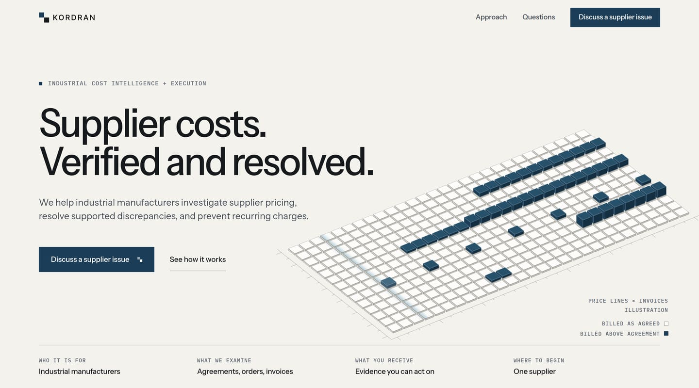

# Kordran digital identity

This folder documents the identity behind kordran.com: what was studied, what
was considered, what was chosen, and how the site is built from that choice.
Read it before changing layout, color, type, motion, or the hero drawing.

## The idea in one paragraph

Kordran compares what a manufacturer agreed to pay with what it was billed.
The identity draws that comparison as a **surface plate**: a grid of machined
tiles, one per invoice line, where a tile that matches the agreement sits
flush and a tile billed above it stands proud in the brand teal. The same
projection, tones, and tile unit draw every other figure on the site, so the
hero, the worked example, and the Approach page read as one drawing set. The
Industrial Wash painting closes each page and is the only warm, expressive
image on the site.

## Documents

| # | Document | What it answers |
| - | -------- | --------------- |
| 1 | [Research dossier](01-research.md) | Which sites were studied, what was observed, what applies to Kordran |
| 2 | [Creative strategy](02-strategy.md) | What the identity is and why it fits the business |
| 3 | [Three concepts](03-concepts.md) | The directions that were prototyped, and the signature-visual options |
| 4 | [Selection](04-selection.md) | Scores, reasoning, and the direction chosen |
| 5 | [Information architecture](05-architecture.md) | Pages, sections, navigation, anchors |
| 6 | [Copy](06-copy.md) | Every line of published text and the rules it follows |
| 7 | [Design system](07-design-system.md) | Tokens, grid, type, graphic vocabulary, motion, components |
| 8 | [QA and validation](08-validation.md) | Screenshots, corrected defects, performance and accessibility results |
| 9 | [Creative critique](09-critique.md) | What is distinctive, what was traded away, what to improve next |

## Prototypes

The three directions were built as working pages before one was chosen. They
are plain HTML and open directly in a browser.

- [`prototypes/direction-a-register.html`](prototypes/direction-a-register.html)
- [`prototypes/direction-b-plate.html`](prototypes/direction-b-plate.html) with
  [`prototypes/plate.js`](prototypes/plate.js). This is the interactive
  prototype of the signature visual. It accepts query parameters for
  exploration: `still`, `accent`, `view`, `cx`, `cy`, `az`, `el`.
- [`prototypes/direction-c-exhibit.html`](prototypes/direction-c-exhibit.html)

## Where the identity lives in the code

| Concern | File |
| ------- | ---- |
| Tokens and every component style | `src/app/globals.css` |
| Plate geometry, tones, camera (single source) | `src/components/plate/model.ts` |
| Plate as server-rendered SVG | `src/components/plate/PlateArt.tsx` |
| Plate as WebGL scene | `src/components/plate/scene.ts`, `PlateField.tsx` |
| Axonometric figures | `src/components/figures/axo.ts`, `scenes.ts`, `Axo.tsx` |
| Worked example | `src/components/ExposureExhibit.tsx`, `src/lib/example.ts` |
| Closing painting and footer | `src/components/CloseScene.tsx`, `Footer.tsx` |
